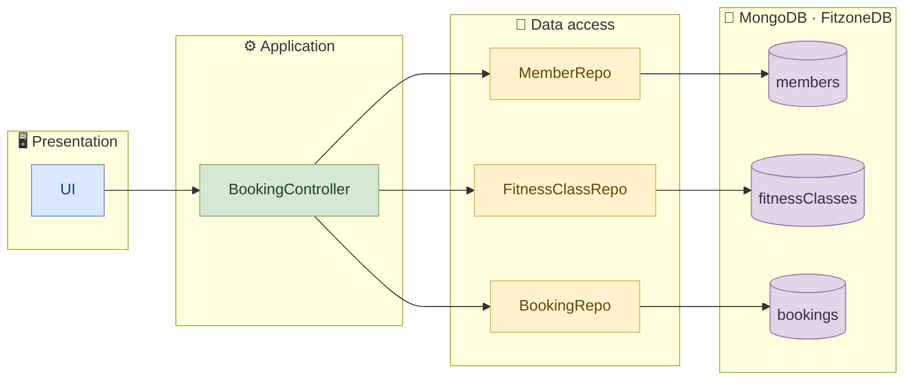
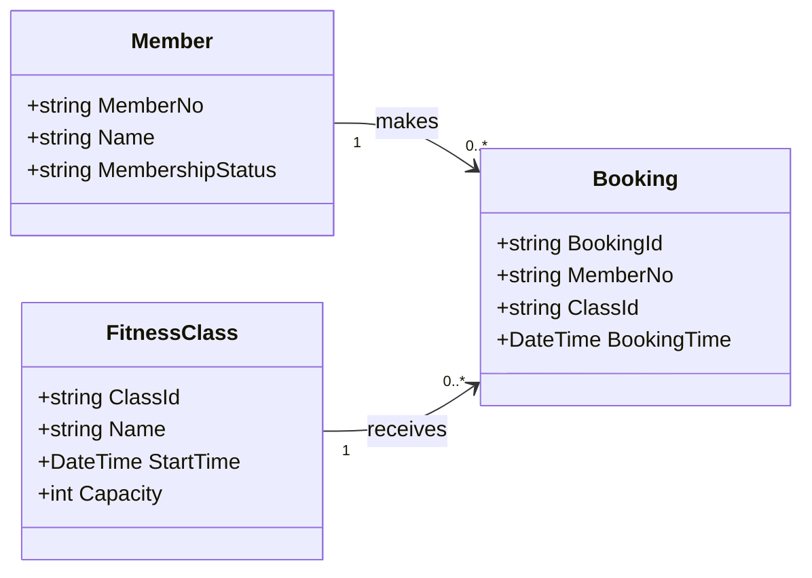

<div align="center">

# 🏋️ FitZone

**A fitness-class booking system built with a clean three-layer architecture.**


[Overview](#-overview) · [Architecture](#-architecture) · [Domain model](#-domain-model) · [Getting started](#-getting-started) · [Project structure](#-project-structure) · [Roadmap](#-roadmap)

</div>

---

## ✨ Overview

FitZone lets gym members browse upcoming fitness classes and book a place in one.
The project was designed up front as a UML class diagram, and the code mirrors that design layer by layer:
a console UI talks to a controller, the controller talks to repositories, and the repositories talk to MongoDB.

> [!NOTE]
> **Current state: skeleton.** All classes, fields and method signatures from the design diagram are in place and the solution compiles,
> but the method bodies are not implemented yet (they throw `NotImplementedException`). See the [roadmap](#-roadmap).

### Planned use case: *Book a class*

| Step | What happens |
| :-: | --- |
| 1 | The member views the list of upcoming classes |
| 2 | The member picks a class and enters their member number |
| 3 | The system checks the member, the class, duplicate bookings and remaining capacity |
| 4 | A booking is created and a confirmation (or an error message) is shown |

---

## 🏛 Architecture

FitZone is split into four tiers. Each one only depends on the tier directly below it.



| Layer | Class | Responsibility |
| --- | --- | --- |
| Presentation | `UI` | Console interaction: shows classes, collects input, prints confirmations and errors |
| Application | `BookingController` | Business rules for browsing and booking classes |
| Data access | `MemberRepo`, `FitnessClassRepo`, `BookingRepo` | One repository per MongoDB collection |
| Database | `FitzoneDB` | Collections `members`, `fitnessClasses`, `bookings` |

`Program.cs` is the composition root: it opens the Mongo connection, builds the repositories, injects them into the controller, injects the controller into the UI and calls `Run()`.

---

## 🧩 Domain model



### Public API (per the design)

<details>
<summary><b>BookingController</b></summary>

```csharp
List<FitnessClass> GetUpcomingClasses();
Booking BookClass(string memberNo, string classId);
```
</details>

<details>
<summary><b>Repositories</b></summary>

```csharp
// MemberRepo
Member?  GetByMemberNo(string memberNo);

// FitnessClassRepo
List<FitnessClass> GetUpcoming(DateTime now);
FitnessClass?      GetById(string classId);

// BookingRepo
int  CountByClassId(string classId);
bool Exists(string memberNo, string classId);
Booking Add(Booking b);
```
</details>

<details>
<summary><b>UI</b></summary>

```csharp
void Run();                              // entry point called from Program.cs
List<FitnessClass> ShowUpcomingClasses();
Booking BookClass(string memberNo, string classId);
private string ShowConfirmation(Booking b);
private string ShowError(string message);
```
</details>

---

## 🚀 Getting started

### Prerequisites

- [.NET 10 SDK](https://dotnet.microsoft.com/download)
- [MongoDB](https://www.mongodb.com/try/download/community) running on `mongodb://localhost:27017`

### Build

```bash
git clone <your-repo-url>
cd FitZone/FitZoneApp
dotnet build
```

### Run

```bash
dotnet run --project FitZoneApp
```

> [!WARNING]
> Until the method bodies are implemented, running the app will stop with a `NotImplementedException` from `UI.Run()`.

The database name (`FitzoneDB`) and connection string are set in [`Program.cs`](FitZoneApp/FitZoneApp/Program.cs).

---

## 📁 Project structure

```text
FitZone/
├── README.md
└── FitZoneApp/
    ├── FitZoneApp.sln
    └── FitZoneApp/
        ├── Program.cs                  # composition root
        ├── GUI/
        │   └── UI.cs                   # presentation layer
        ├── Controllers/
        │   └── BookingController.cs    # application layer
        ├── Repositories/
        │   ├── MemberRepo.cs           # data access layer
        │   ├── FitnessClassRepo.cs
        │   └── BookingRepo.cs
        └── Models/
            ├── Member.cs               # entities
            ├── FitnessClass.cs
            └── Booking.cs
```

---

## 🛠 Tech stack

| | |
| --- | --- |
| Language | C# on .NET 10 (nullable reference types enabled) |
| Database | MongoDB via `MongoDB.Driver` 3.13 |
| Interface | Console application |

---

## 🗺 Roadmap

- [x] Design class diagram
- [x] Project skeleton with all layers, classes and signatures
- [ ] Repository queries (`GetUpcoming`, `GetById`, `Exists`, `CountByClassId`, `Add`, `GetByMemberNo`)
- [ ] Booking rules in `BookingController.BookClass`
- [ ] Console menu in `UI.Run`
- [ ] Seed data for members and classes
- [ ] Tests
