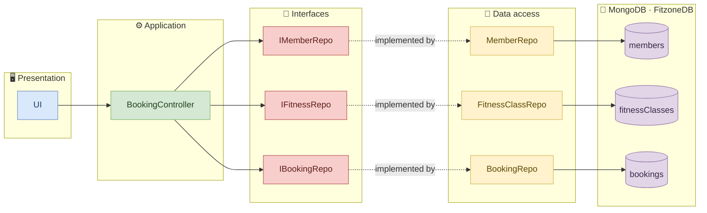
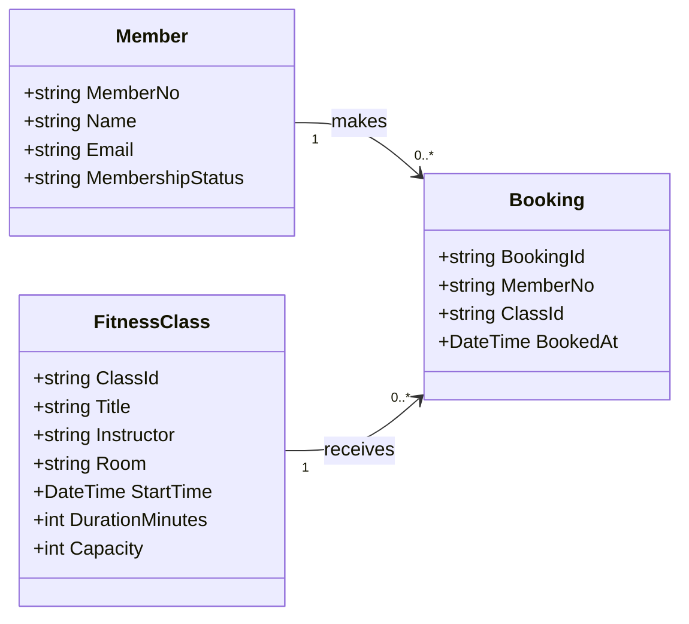

<div align="center">

# 🏋️ FitZone

**A fitness-class booking system built with a clean layered architecture.**


[Overview](#-overview) · [Architecture](#-architecture) · [Domain model](#-domain-model) · [Getting started](#-getting-started) · [Project structure](#-project-structure) · [Roadmap](#-roadmap)

</div>

---

## ✨ Overview

FitZone lets gym members browse upcoming fitness classes and book a place in one.
The project was designed up front as a UML class diagram, and the code mirrors that design layer by layer:
a console UI talks to a controller, the controller talks to repository interfaces, and the repositories behind them talk to MongoDB.

> [!NOTE]
> **Current state: working prototype.** Browsing upcoming classes and booking a class both work end to end against MongoDB,
> including validation and error handling. Tests and seed data are still missing. See the [roadmap](#-roadmap).

### Use case: *Book a class*

| Step | What happens |
| :-: | --- |
| 1 | The member views the list of upcoming classes |
| 2 | The member picks a class and enters their member number |
| 3 | The system checks the member, the class, duplicate bookings and remaining capacity |
| 4 | A booking is created and a confirmation (or an error message) is shown |

### Booking rules

`BookingController.BookClass` checks these rules in order and stops at the first one that fails:

1. Member number and class id are not empty
2. The member exists
3. The membership is `Active`
4. The class exists
5. The class has not started yet
6. The member has not already booked this class
7. The class is not full (bookings < `Capacity`)

### Error handling

| Kind of error | Where it is raised | What the user sees |
| --- | --- | --- |
| A booking rule is broken | `BookingController` throws a `BookingException` | A red ✖ message explaining why, e.g. *"Crossfit is full"* |
| Duplicate booking slips through | `BookingRepo.Add` turns Mongo's duplicate-key error into a `BookingException` | *"Member … has already booked class …"* |
| Database down or unreachable | MongoDB driver throws `MongoException` / `TimeoutException` | *"Could not reach the database. Please try again later."* |

The `UI` catches these exceptions, so a failed booking never crashes the app. A successful booking prints a green ✔ confirmation.

---

## 🏛 Architecture

FitZone is split into layers. Each one only depends on the layer directly below it.
The controller never talks to a concrete repository: it only knows the repository **interfaces**, and the repositories implement them.



Solid arrows mean "uses", dotted arrows mean "is implemented by".

| Layer | Class | Responsibility |
| --- | --- | --- |
| Presentation | `UI` | Console interaction: shows classes, collects input, prints confirmations and errors |
| Application | `BookingController` | Business rules for browsing and booking classes |
| Interfaces | `IMemberRepo`, `IFitnessRepo`, `IBookingRepo` | Contracts the controller depends on; they describe *what* data operations exist, not *how* they are done |
| Data access | `MemberRepo`, `FitnessClassRepo`, `BookingRepo` | One repository per MongoDB collection, each implementing its interface |
| Database | `FitzoneDB` | Collections `members`, `fitnessClasses`, `bookings` |

### Why interfaces?

`BookingController` takes `IMemberRepo`, `IFitnessRepo` and `IBookingRepo` in its constructor, not the concrete Mongo classes.
That means any class implementing those interfaces can be passed in, for example an in-memory fake for unit tests or a different database,
without changing a single line of the controller.

`Program.cs` is the composition root and the only place that knows which concrete classes are used: it opens the Mongo connection,
creates the repositories, passes them into the controller as their interfaces, passes the controller into the UI and calls `Run()`.

---

## 🧩 Domain model



### How the models map to MongoDB

Each model's id property is marked with `[BsonId]`, so it is stored as the document's `_id`.
All other property names match the field names in the database exactly.

| Model | `_id` property | Example `_id` | Collection |
| --- | --- | --- | --- |
| `Member` | `MemberNo` | `"M1001"` | `members` |
| `FitnessClass` | `ClassId` | `"C203"` | `fitnessClasses` |
| `Booking` | `BookingId` | `"M1001-C201"` | `bookings` |

A booking's id is the member number and class id joined with a dash. Because `_id` must be unique,
MongoDB itself refuses a second booking of the same class by the same member.

All times (`StartTime`, `BookedAt`) are stored in UTC, and the code compares them against `DateTime.UtcNow`.

### Public API

<details>
<summary><b>BookingController</b></summary>

```csharp
List<FitnessClass> GetUpcomingClasses();
Booking BookClass(string memberNo, string classId);   // throws BookingException if a rule is broken
```
</details>

<details>
<summary><b>Repository interfaces</b></summary>

```csharp
// IMemberRepo     (implemented by MemberRepo, InMemoryMemberRepo)
Member? GetByMemberNo(string memberNo);

// IFitnessRepo    (implemented by FitnessClassRepo, InMemoryFitnessClassRepo)
List<FitnessClass> GetUpcoming(DateTime now);
FitnessClass?      GetById(string classId);

// IBookingRepo    (implemented by BookingRepo, InMemoryBookingRepo)
void Add(Booking b);
bool Exists(string memberNo, string classId);
int  CountByClassId(string classId);
```
</details>

<details>
<summary><b>UI</b></summary>

```csharp
void Run();                                  // entry point called from Program.cs
void ShowUpcomingClasses();                  // prints the upcoming classes
void BookClass(string memberNo, string classId);
private void ShowConfirmation(Booking b);    // green ✔ message
private void ShowError(string message);      // red ✖ message
```
</details>

---

## 🚀 Getting started

### Prerequisites

- [.NET 10 SDK](https://dotnet.microsoft.com/download)
- A MongoDB database: [MongoDB Atlas](https://www.mongodb.com/atlas) or a [local install](https://www.mongodb.com/try/download/community).
  Not needed if you run with the in-memory database (see [Configuration](#configuration)).

### Build

```bash
git clone <your-repo-url>
cd FitZone/FitZoneApp
dotnet build
```

### Run

```bash
dotnet run --project FitZoneApp
```

The app shows a menu where you can view upcoming classes (option 1) or book a class (option 2).

> [!IMPORTANT]
> In Mongo mode there is no seed script yet, so the `FitzoneDB` database must already contain documents in the `members` and `fitnessClasses`
> collections (see [How the models map to MongoDB](#how-the-models-map-to-mongodb) for the expected shape).
> The in-memory database comes with its own sample data.

### Configuration

Settings are read from [`appsettings.json`](FitZoneApp/FitZoneApp/appsettings.json),
which is copied next to the executable on build:

```json
{
  "ConnectionStrings": {
    "FitzoneDB": "mongodb://localhost:27017"
  },
  "Database": {
    "Provider": "Mongo",
    "Name": "FitzoneDB"
  }
}
```

| Setting | Values | Meaning |
| --- | --- | --- |
| `Database:Provider` | `Mongo` (default) or `InMemory` | Which set of repositories `Program.cs` creates |
| `ConnectionStrings:FitzoneDB` | MongoDB connection string | Only used in `Mongo` mode |
| `Database:Name` | Database name | Only used in `Mongo` mode |

If a required value is missing, the app stops at startup with a message saying which one.

### In-memory database

With `"Provider": "InMemory"` the app uses `InMemoryMemberRepo`, `InMemoryFitnessClassRepo` and `InMemoryBookingRepo`,
which keep their data in lists instead of MongoDB. No database is needed, and everything resets when the app closes.
They implement the same interfaces as the Mongo repositories, so the controller and UI work unchanged.

The sample data is chosen so every booking rule can be tried out:

| Try booking | Member | Class | Result |
| --- | --- | --- | --- |
| A normal booking | `M1002` | `C203` | ✔ Confirmed |
| The same booking again | `M1002` | `C203` | ✖ Already booked |
| An inactive member | `M1003` | any | ✖ Membership not active |
| A class that has started | any active | `C201` | ✖ Already started |
| A full class | `M1002`, then `M1004` | `C202` | ✔ then ✖ Full (2 spots, 1 taken by `M1001` from the start) |
| An unknown member | `M9999` | any | ✖ No member with that number |

Class start times are set relative to today, so `C202`–`C205` are always upcoming.

---

## 📁 Project structure

```text
FitZone/
├── README.md
└── FitZoneApp/
    ├── FitZoneApp.sln
    └── FitZoneApp/
        ├── Program.cs                  # composition root
        ├── GUI/
        │   └── UI.cs                   # presentation layer
        ├── Controllers/
        │   └── BookingController.cs    # application layer
        ├── Interfaces/
        │   ├── IMemberRepo.cs          # repository contracts
        │   ├── IFitnessRepo.cs
        │   └── IBookingRepo.cs
        ├── Exceptions/
        │   └── BookingException.cs     # booking rule violations
        ├── appsettings.json            # database provider and connection settings
        ├── Repositories/
        │   ├── MemberRepo.cs           # data access layer (MongoDB)
        │   ├── FitnessClassRepo.cs
        │   ├── BookingRepo.cs
        │   └── InMemory/
        │       ├── InMemoryMemberRepo.cs        # data access layer (in-memory, with sample data)
        │       ├── InMemoryFitnessClassRepo.cs
        │       └── InMemoryBookingRepo.cs
        └── Models/
            ├── Member.cs               # entities
            ├── FitnessClass.cs
            └── Booking.cs
```

---

## 🛠 Tech stack

| | |
| --- | --- |
| Language | C# on .NET 10 (nullable reference types enabled) |
| Database | MongoDB via `MongoDB.Driver` 3.13, or an in-memory database |
| Configuration | `appsettings.json` via `Microsoft.Extensions.Configuration.Json` |
| Interface | Console application |

---

## 🗺 Roadmap

- [x] Design class diagram
- [x] Project skeleton with all layers, classes and signatures
- [x] Repository interfaces, injected into the controller
- [x] Models mapped to the MongoDB documents
- [x] Repository queries (`GetUpcoming`, `GetById`, `Exists`, `CountByClassId`, `Add`, `GetByMemberNo`)
- [x] Booking rules in `BookingController.BookClass`
- [x] Console menu in `UI.Run`
- [x] Error handling with `BookingException`
- [x] Settings in `appsettings.json`
- [x] In-memory database with sample data
- [ ] Seed data for the MongoDB database
- [ ] Tests
